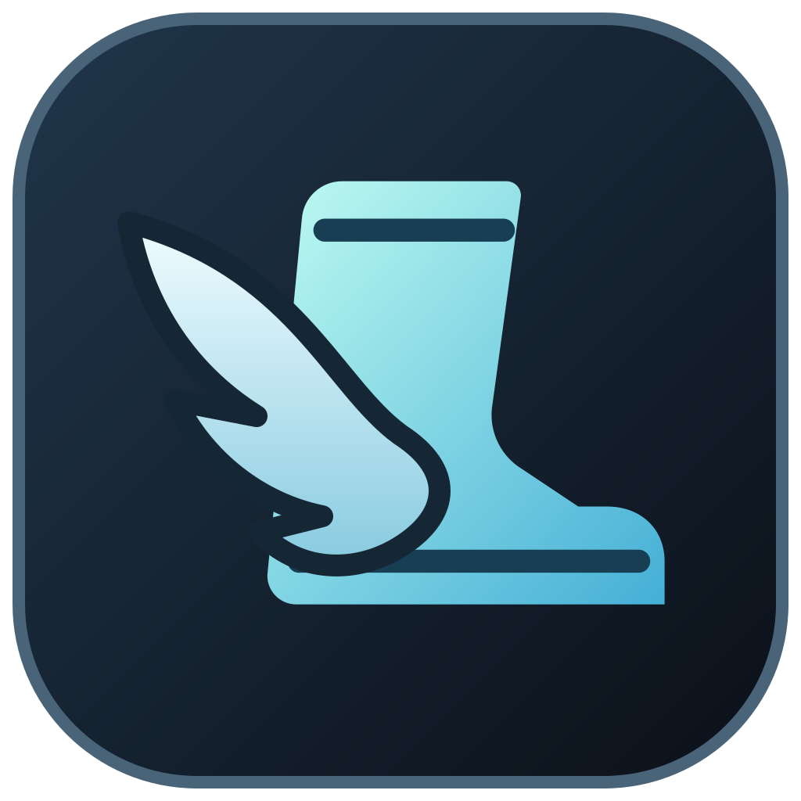
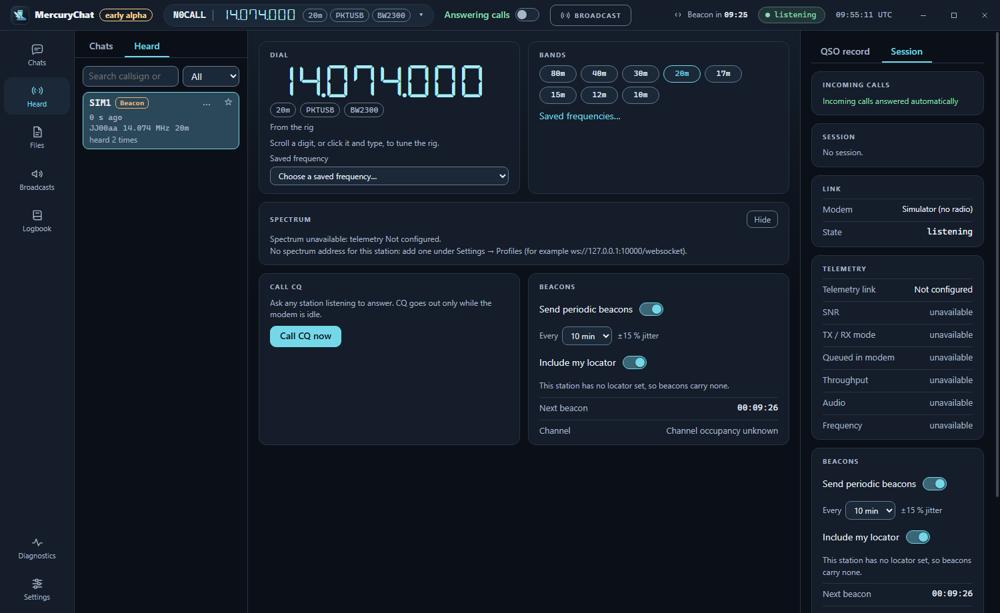
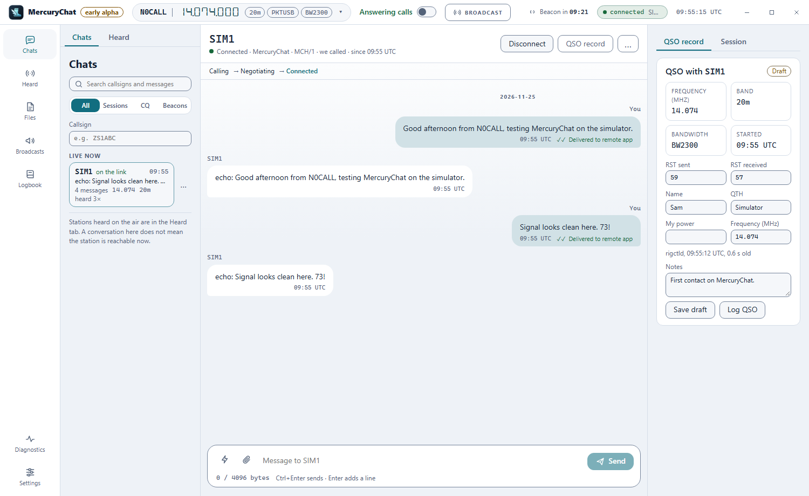
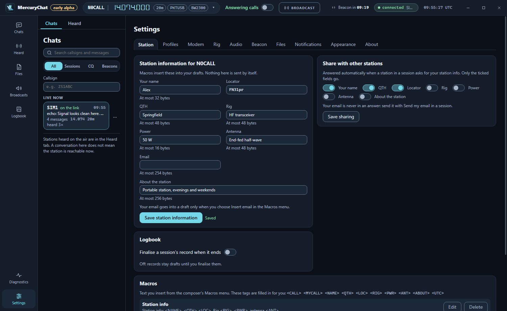

#  MercuryChat

Open-source HF radio messaging for Windows and Linux, powered by the Mercury HF modem.

Founded by ZS6SHZ. Updates: [releases](https://github.com/armysarge/mercurychat/releases).

[Roadmap](#roadmap) · [Changelog](CHANGELOG.md) · [Modem lab](lab/README.md) · [CI workflow](.github/workflows/ci.yml) · [Report an issue](https://github.com/armysarge/mercurychat/issues)

> **Early alpha: under active development.** MercuryChat is not ready for on-air use. Nothing is released, interfaces and stored data may change without notice, and it has not been tested on air.

**Status:** the beta features are built and tested against a built-in simulator, real Mercury modems over virtual audio and Hamlib dummy rigs. No radio transmissions have been made, and rig control has not been tried on a real radio. Raspberry Pi testing is still to be done.

## Features

- **Chat** with calls and auto-answer, a saved outbox and delivery receipts from the other station. After a failure, unconfirmed messages are marked uncertain and are not resent by themselves.
- **Discovery:** CQ, opt-in beacons, short broadcast messages and a heard list. No broadcast is ever shown as confirmed received.
- **Files:** the receiver accepts or declines first. Files are compressed, photos are shrunk with their metadata removed, and a file that fails its checksum is not saved.
- **Rig control:** the bundled or your own Hamlib `rigctld`, FLRig, or built-in CAT control with importable command files (Icom IC-7300, Yaesu FT-991A and Kenwood TS-590S/SG included).
- **Station tools:** QSO logging with ADIF and CSV export, QSY proposals, SNR and station information requests, macros, history search and notifications.
- **Setup:** a built-in Mercury modem or your own, a first-run wizard and a diagnostics file.
- **Languages:** English, Spanish, French and Brazilian Portuguese.

## At a glance

| QSO record | Logbook |
| --- | --- |
|  |  |

## Design aim

MercuryChat should feel like the chat apps people already use every day: a conversation list, message bubbles, a composer that is always ready, and clear delivery status. It should not feel like a wall of modem controls. Radio detail is there when you want it and out of the way when you don't. Screens stay calm and uncluttered, readable at a glance, and friendly to newcomers, while experienced operators keep the controls they rely on.

## Roadmap

| When | What |
| --- | --- |
| **Public beta**, mid-December 2026 | Windows and Linux: chat, discovery, files, rig control and logging. First a security and optimization audit and a clean install test on Windows. |
| **1.0**, February 2027 | Encryption and signed messages, on-air field testing, a benchmark against VARA HF and Raspberry Pi support. |
| **After 1.0** | An animated tour, remote station control and a mobile app, mail and relay, a GPS link with a world map and PSK Reporter, other integrations, frequency slots and a user manual. |
| **Later** | Games over the air, such as tic-tac-toe, battleships and chess. |

These dates are targets, not promises. See the [full roadmap](ROADMAP.md).
