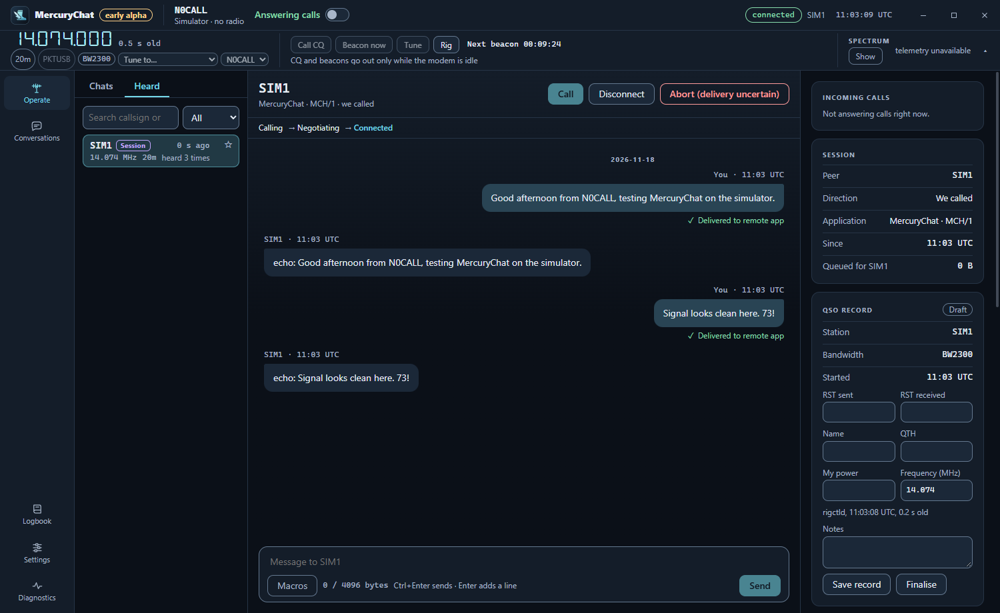
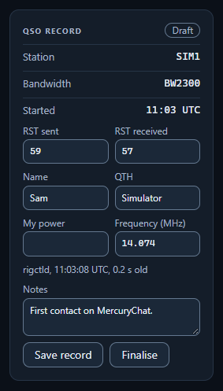
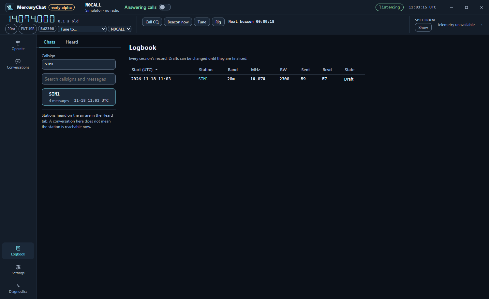
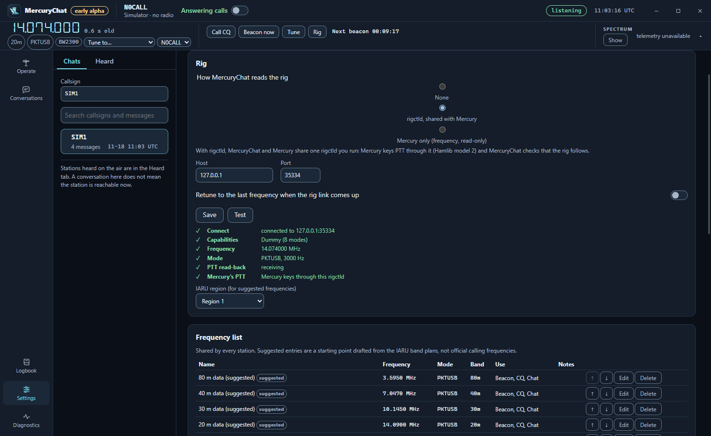

#  MercuryChat

Open-source HF radio messaging for Windows and Linux, powered by the Mercury HF modem.

Founded by ZS6SHZ. Updates: [releases](https://github.com/armysarge/mercurychat/releases).

[](#immediate-next-milestone)
[](src-tauri/tauri.conf.json)
[](Cargo.toml)

[](https://www.rust-lang.org/)
[](https://v2.tauri.app/)
[](https://vuejs.org/)
[](https://www.typescriptlang.org/)
[](https://sqlite.org/)

[Changelog](CHANGELOG.md) · [Modem lab](lab/README.md) · [CI workflow](.github/workflows/ci.yml) · [Report an issue](https://github.com/armysarge/mercurychat/issues)

> **Early alpha: under active development.** MercuryChat is not ready for on-air use. Nothing is released, interfaces and stored data may change without notice, and it has not been tested on air.

**Roadmap:** a public beta for Windows and Linux is planned for **mid-December 2026**. It covers chat, CQ and beacons, the heard list, rig control and file transfer. The first stable release (1.0) is targeted for **February 2027**, after on-air field testing and Raspberry Pi qualification. These dates are targets, not promises.

**Status:** M0 (modem-integration proof) closed 15 November 2026, with the Raspberry Pi run carried as an exception ([go/no-go note](docs/M0-go-no-go.md)); M1 (desktop foundation): the foundation is built (station profiles, migrations with backups, single-instance data locks, logs and crash reports, the typed command/event contract, and an in-process simulator modem the window runs on). M1 exits after the Raspberry Pi smoke test ([M1 progress](docs/M1-progress.md)). M2 (connected messaging) is built on branch `m2-chat`: calls and auto-answer over a real Mercury, MCH/1 negotiation, a durable outbox with end-to-end receipts and duplicate suppression, abort and recovery that mark unconfirmed messages uncertain instead of resending them, and the chat workspace (first-use setup, conversations, transcript, composer, session pane). Messages round-trip between the Windows app and Mercury on Linux, and over virtual audio cables on Windows. M3a (discovery and operator tools) is built on branch `m3a`: the heard list from CQs, beacons and sessions; Call CQ, Beacon now and opt-in periodic beacons behind an idle-only gate; listening by default with a Receive only switch; Mercury telemetry and an optional waterfall; a QSO card and Logbook; macros and history search; desktop notifications; and the Operate station strip. It was checked against two real Mercury modems over virtual audio cables ([M3 progress](docs/M3-progress.md)). M3b (rig control) is built on branch `m3b`: MercuryChat connects to the rigctld the operator runs, shared with Mercury, which keys PTT through it. The station strip is the rig panel (digit tuning, band, mode, the frequency list, Tune with a 30 s stop, per-band TX levels), every change is refused while busy, and PTT is cross-checked against Mercury. Settings is now in tabs, with a Rig tab holding a link test, the frequency list (suggested IARU entries per region), TX levels and an optional QSY schedule. It was checked against two real Mercury modems keying a Hamlib dummy rig in Docker. None of it is yet tested on air or on a Raspberry Pi. No radio transmissions have been made. Progress, evidence and open items: [docs/M0-progress.md](docs/M0-progress.md); how to reproduce: [lab/README.md](lab/README.md).

## At a glance

These screenshots come from the real app running on its built-in simulator, with the demo callsign N0CALL. `scripts/screenshots.mjs` produces them, so they are never captured by hand.



| QSO card | Logbook |
| --- | --- |
|  |  |



## Design aim

MercuryChat should feel like the chat apps people already use every day: a conversation list, message bubbles, a composer that is always ready, and clear delivery status. It should not feel like a wall of modem controls. Radio detail is there when you want it and out of the way when you don't. Screens stay calm and uncluttered, readable at a glance, and friendly to newcomers, while experienced operators keep the controls they rely on.

## Decisions confirmed with the owner

- Windows and Ubuntu/Debian-family Linux desktop app with a modern, polished interface.
- Raspberry Pi/Linux ARM64 support is required for Core 1.0; Pi 4/5 with a 64-bit OS are the proposed qualification targets.
- Initial modem tests use two crossed virtual audio routes, with physical PTT disabled.
- VarAC-inspired operating workflows, using Mercury as the modem.
- Open-source distribution.
- Core features first: connected chat, CQ/beacons, heard stations, file transfers and QSO logging.
- Support both managed local Mercury and an existing local or remote Mercury installation.

## Read in this order

1. [Product specification](docs/01-product-specification.md)
2. [Architecture and technology decisions](docs/02-architecture.md)
3. [Mercury integration and proposed application protocol](docs/03-modem-and-protocol.md)
4. [Interface and experience specification](docs/04-ui-specification.md)
5. [Implementation roadmap and acceptance gates](docs/05-implementation-plan.md)
6. [Evidence, risks and open decisions](docs/06-evidence-and-decisions.md)
7. [Virtual audio and Raspberry Pi qualification](docs/07-virtual-audio-and-raspberry-pi.md)

The technology selection, protocol draft, support matrix and estimates are proposals. The product choices above are confirmed; exact Pi model, memory floor and OS versions remain qualification targets. Implementation milestones are subsequent work; this phase delivers their specification.

## Proposed technical direction

Tauri 2 desktop shell, Vue 3 + TypeScript interface, Rust application services and SQLite persistence. Mercury runs as a separate process with a tested, pinned version. TCP provides modem control, connected data and broadcasts; optional WebSocket telemetry supplies audio health and spectrum information.

MercuryChat-to-MercuryChat interoperability is the initial target. A VARA-like host interface does not make Mercury's waveform compatible with VARA, and it does not establish compatibility with VarAC's application protocol. No VarAC code, assets or proprietary formats are incorporated in this plan.

## Immediate next milestone

M3c: operator extras (QSY proposals, information requests, extended beacons). The Raspberry Pi smoke test carried from M0 ([go/no-go note](docs/M0-go-no-go.md)) is still open: M1, M2, M3a and M3b exit on the Pi when it passes.

## Regenerate the app icons

The [MercuryChat logo](apps/desktop/public/mercurychat.svg) is the source for the desktop header, favicon and native icons. From the repository root, generate the icon set with Tauri, then copy the updated desktop files into `src-tauri/icons`:

```bash
npm run tauri -- icon apps/desktop/public/mercurychat.svg --output target/generated-icons
```
